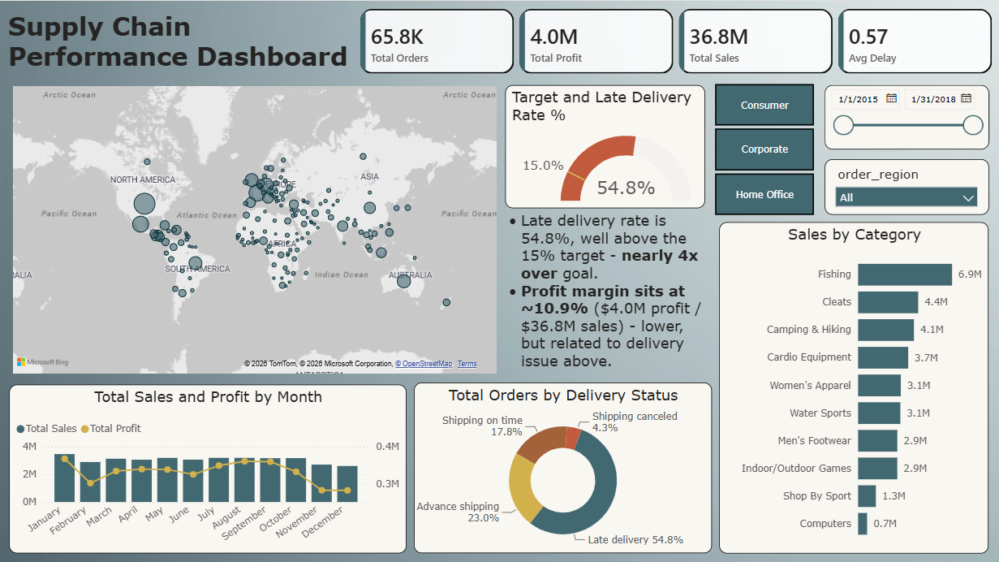
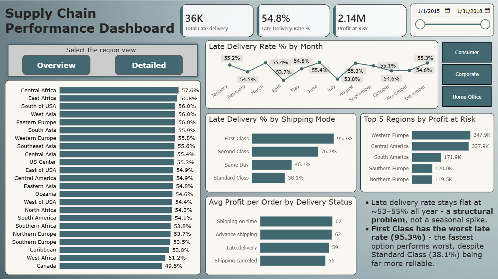
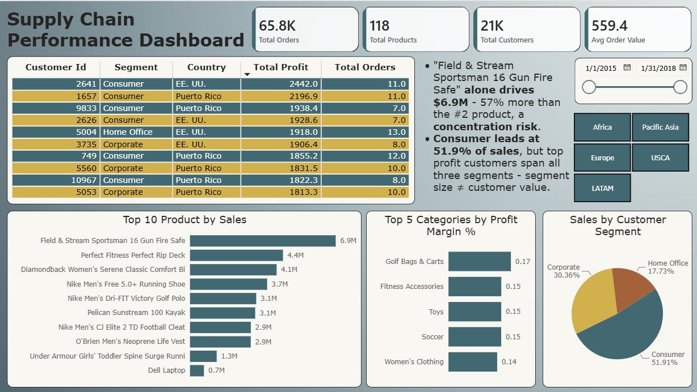

# Supply Chain Performance Dashboard

A three-page Power BI report on the DataCo supply chain dataset (65,752 orders, 180,519 order lines). I designed the PostgreSQL star schema behind it, loaded the raw CSV with staged `COPY` imports, and wrote every business metric as a DAX measure. The report connects directly to the database.



## Contents

- [Overview](#overview)
- [Tech stack](#tech-stack)
- [Data model](#data-model)
- [Dashboard pages](#dashboard-pages)
- [DAX measures](#dax-measures)
- [Project structure](#project-structure)
- [Setup](#setup)
- [Dataset](#dataset)
- [Contact](#contact)

## Overview

The source is one wide, denormalized CSV. The project splits it into normalized tables in PostgreSQL and builds a report on top that answers three questions: how often deliveries are late, where and through which shipping mode, and which products and customers carry sales and profit.

Power BI reads from the database, and the report holds no pre-computed columns. Each KPI is a DAX measure.

## Tech stack

| Layer | Tool | Used for |
|---|---|---|
| Database | PostgreSQL | Star schema, indexes |
| Loading | SQL: `COPY`, staging tables, `INSERT` | Loading the raw CSVs and splitting them into dimension and fact tables |
| Reporting | Power BI Desktop | Data connection, DAX measures, bookmarks, three report pages |

## Data model

The schema has two fact tables and four dimension tables.

| Table | Type | Contents |
|---|---|---|
| `fact_orders` | Fact | 65,752 rows, one per order: dates, shipping mode, delivery status, late delivery flag |
| `fact_order_items` | Fact | 180,519 rows, one per order line: sales, discount, profit |
| `dim_customers` | Dimension | Customer lookup |
| `dim_products` | Dimension | Product lookup |
| `dim_categories` | Dimension | Product category lookup |
| `dim_departments` | Dimension | Department lookup |

```
dim_customers (1) --- (N) fact_orders (1) --- (N) fact_order_items (N) --- (1) dim_products
dim_products (N) --- (1) dim_categories
dim_products (N) --- (1) dim_departments
```

Email, password, name, street and zipcode fields from the source file are not loaded into the schema.

`setup.sql` holds the whole database build: table creation, indexes, staging tables, and the `COPY` and `INSERT` statements that fill the schema from the raw CSVs. Its last query prints the row count of each table.

## Dashboard pages

### Page 1: Executive Overview

The page shown at the top of this README. It has KPI cards for Total Orders, Late Delivery Rate and Profit at Risk, a world map of order volume, a Sales and Profit combo chart, a delivery status breakdown and a category sales ranking.

The late delivery rate is 54.8%, about 3.7 times the 15% target.

### Page 2: Delivery Performance

This page shows late delivery rate by shipping mode and by region, a monthly trend and profit by delivery status. A bookmark switches the regional view between a simple chart and a heatmap matrix of region by shipping mode.

First Class, the fastest shipping option, has the highest late rate at 95.3%. Standard Class is at 38.1%. In the source data, all 27,814 First Class order lines are scheduled for a one-day shipment.



### Page 3: Product and Customer Insights

This page has top products by sales, profit margin by category, sales by customer segment and a table of the top 10 customers by profit.

One product, "Field & Stream Sportsman 16 Gun Fire Safe", has $6.9M in sales, 57% above the next highest product. Sales depend heavily on a single item.



## DAX measures

```dax
Late Delivery Rate % =
DIVIDE(
    COUNTROWS(FILTER(fact_orders, fact_orders[late_delivery_risk] = 1)),
    COUNTROWS(fact_orders)
)

Profit at Risk =
SUMX(
    FILTER(fact_orders, fact_orders[late_delivery_risk] = 1),
    [Total Profit]
)

Profit Margin % =
DIVIDE([Total Profit], [Total Sales])
```

The late delivery measures run on `fact_orders`, so those rates are per order and not per order line. Profit at Risk adds up profit over late orders, and each order's profit comes from its rows in `fact_order_items`. The full measure list is in the `_Measures` table inside the `.pbix` file.

## Project structure

```
supplylens-dashboard/
├── setup.sql                    # schema, indexes, staging tables, COPY load
├── supply_chain_dashboard.pbix  # Power BI report, 3 pages
├── README.md
└── screenshots/                 # exported report pages
```

## Setup

1. Create a PostgreSQL database with `CREATE DATABASE supply_chain;`
2. Open `setup.sql` in pgAdmin or `psql`. In the `COPY` statements (Section 6), change the two file paths to your local copies of `DataCoSupplyChainDataset.csv` and `tokenized_access_logs.csv`.
3. Run the whole script. It creates the tables and indexes, stages the raw CSVs and fills the star schema. Check the final row counts against the Data model section.
4. Open `supply_chain_dashboard.pbix` in Power BI Desktop, update the PostgreSQL connection under Home > Transform data > Data source settings, and refresh.

## Dataset

[DataCo Smart Supply Chain for Big Data Analysis](https://www.kaggle.com/datasets/shashwatwork/dataco-smart-supply-chain-for-big-data-analysis) on Kaggle: 180,519 order-line records across global markets. The same download includes `tokenized_access_logs.csv`, which the setup script also loads.

## Contact

Atharv Dhole

- LinkedIn: https://www.linkedin.com/in/atharv-dhole/
- Email: atharvdhole22@gmail.com
